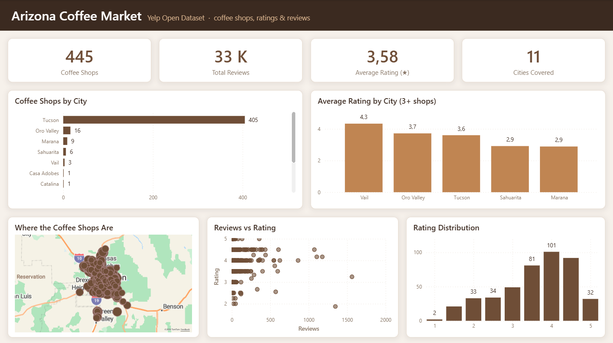
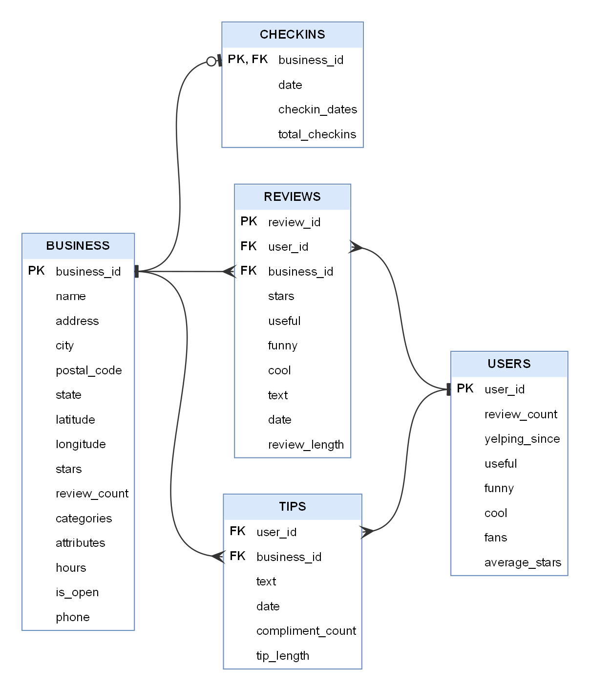

# Coffee Market Analysis
Lean, production-style pipeline for analyzing coffee businesses from the Yelp Open Dataset (Arizona subset).

## What This Project Does
- Filters coffee-related businesses from raw Yelp JSONL files (Arizona subset).
- Builds a clean SQLite database for reproducible analysis.
- Runs SQL queries and exports analysis-ready result tables.
- Includes a Power BI dashboard artifact.

## Key Findings
445 coffee shops in Arizona (Yelp categories such as *Coffee & Tea*, *Cafes*, *Coffee Roasteries*, *Bubble Tea*, *Tea Rooms*).
- **Tucson dominates the market:** 405 shops, 91% of the total. The next largest, Oro Valley, has 16.
- **Ratings are generally positive:** 51% of shops have 4 stars or more, and 62% fall between 3.5 and 4.5. The average is 3.58.
- **Ratings vary by city:** among cities with at least 3 shops, Vail rates highest (4.33) and Marana lowest (2.89). Tucson sits at 3.60.
- **Popularity doesn't mean quality:** review volume barely relates to rating (correlation 0.22).
- **Attention is concentrated:** the 10% most-reviewed shops receive 45% of all reviews. Baja Cafe leads with 1,074 reviews. The median shop has 36.
- **About a quarter of the listings have closed:** 73.5% are still open.

> Review totals use Yelp's `review_count` field (33,492). The review file contains 35,125 reviews for these shops: `review_count` is lower for 291 shops (by 4 on average) and never higher.

## Tech
- Python (`pandas`, `matplotlib`, `sqlite3`)
- SQL (SQLite)
- Power BI
- Testing and linting (`pytest`, `ruff`)

## Dataset
Source: https://business.yelp.com/data/resources/open-dataset/

Required files in `data/raw/`:
- `yelp_academic_dataset_business.json`
- `yelp_academic_dataset_review.json`
- `yelp_academic_dataset_tip.json`
- `yelp_academic_dataset_checkin.json`
- `yelp_academic_dataset_user.json`

## Quick Start
1. Create and activate a virtual environment.
   ```bash
   conda create -n coffee-market python=3.11 -y
   conda activate coffee-market
   ```
2. Install project dependencies:
   ```bash
   pip install -e .
   ```
3. Run:
   ```bash
   coffee-market preprocess --input-dir data/raw --output-dir data/processed
   coffee-market build-db --input-dir data/processed --db-path data/coffee_analysis.db
   coffee-market analyze --db-path data/coffee_analysis.db --sql-file sql/analysis_queries.sql --output-dir reports/sql_results
   coffee-market visualize --db-path data/coffee_analysis.db --output-dir reports/figures
   ```

## Tests
```bash
pip install -e ".[dev]"
pytest
ruff check src tests
```

## Power BI
To update source go to `File -> Options and settings -> Data source settings`.

## Preview


## Data Model

